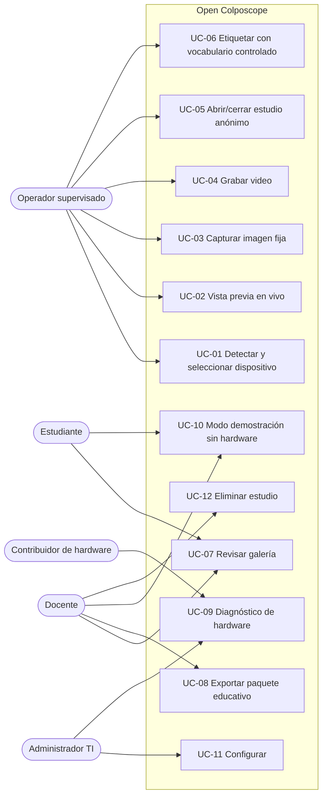
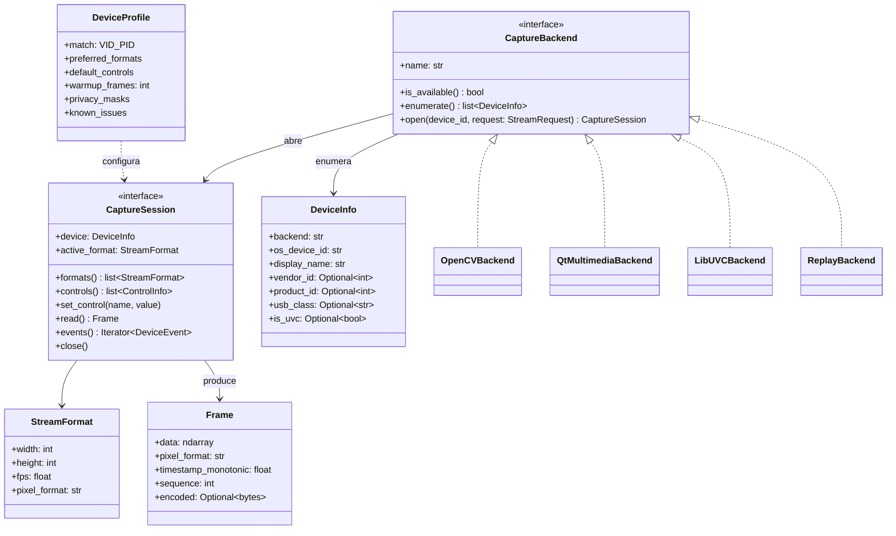
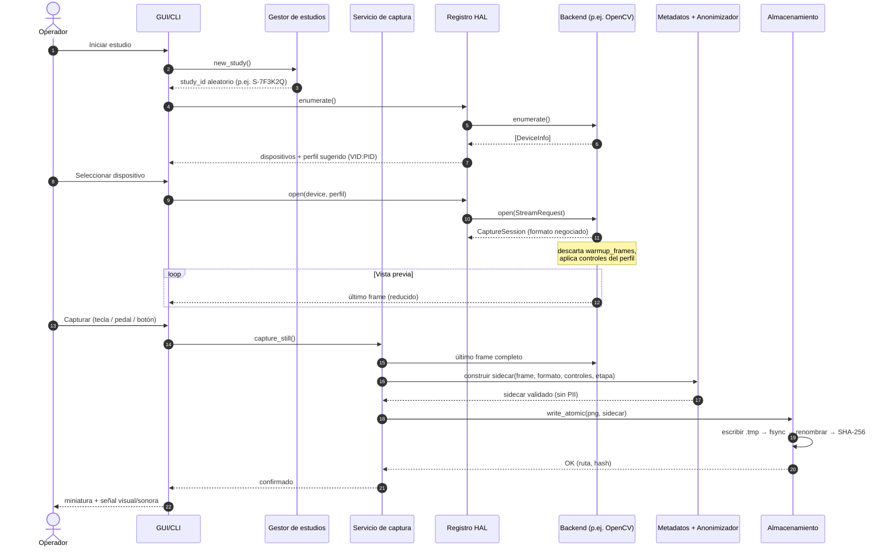
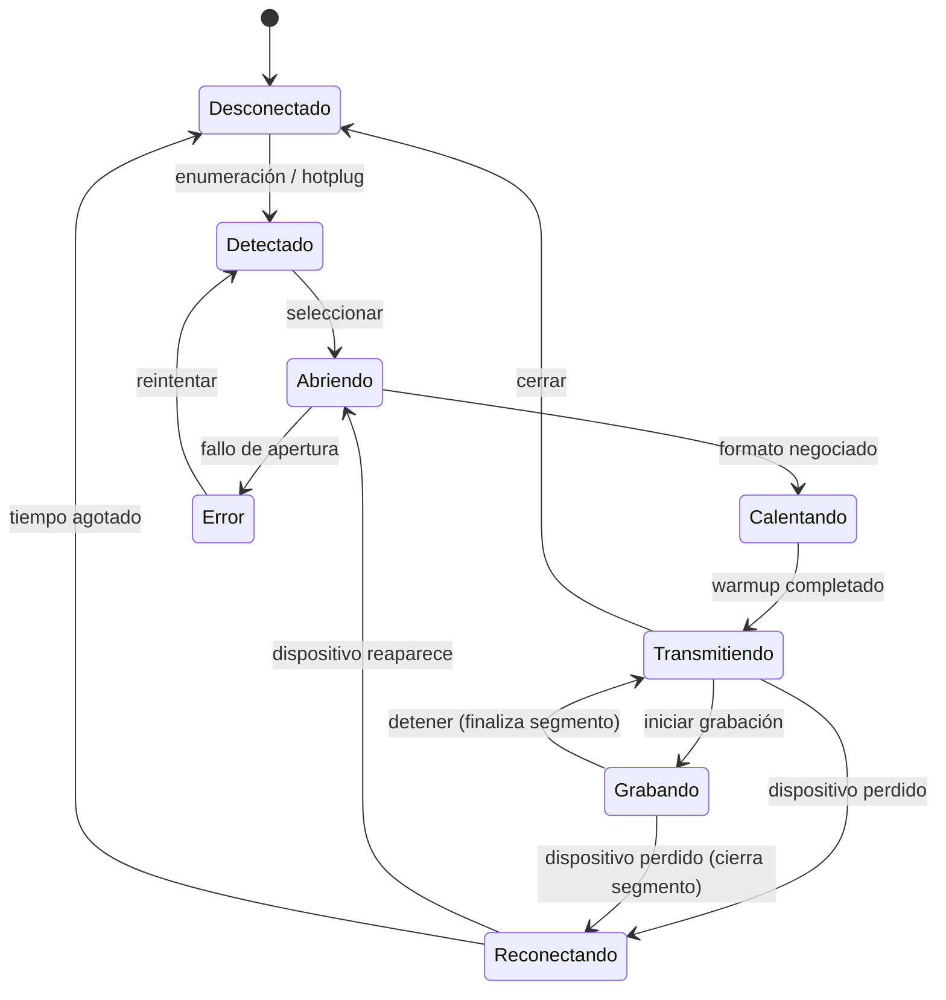

# Arquitectura — Open Colposcope

> **Aviso:** este proyecto es un **prototipo educativo**. **No es un producto médico
> validado** ni está destinado al diagnóstico, tratamiento o toma de decisiones clínicas.

| Campo | Valor |
|---|---|
| Estado | F0 cerrada · F1 en curso |
| Versión del documento | 0.2 |
| Documentos relacionados | [ROADMAP](ROADMAP.md) · [RISKS](RISKS.md) · [HARDWARE](HARDWARE.md) · [STACK](STACK.md) · [CAPTURE](CAPTURE.md) · [PRIVACY](PRIVACY.md) · [LEGAL](LEGAL.md) |

---

## 1. Contexto y propósito

Muchos colposcopios digitales se conectan por USB y se distribuyen con software
propietario cuya licencia está ligada a una llave física (dongle). Cuando el software o la
llave se pierden, caducan o no son asequibles, el equipo óptico queda subutilizado,
especialmente en contextos con recursos limitados.

Este proyecto propone un software **abierto, multiplataforma y offline-first** que capture
imagen fija y video **directamente desde la cámara del colposcopio a través de interfaces
estándar** (principalmente USB Video Class, UVC), **sin ejecutar, modificar, ni interactuar
con el software propietario ni con su dongle**.

La idea central es simple: el dongle licencia *el software del fabricante*, no la cámara.
Si la cámara habla un estándar público (UVC), cualquier sistema operativo moderno ya
la puede leer con su controlador genérico, y nosotros solo construimos una aplicación
de captura respetuosa con la privacidad encima de ese estándar.

## 2. Objetivos

| ID | Objetivo |
|---|---|
| O1 | Capturar **imágenes fijas** y **video** desde colposcopios USB compatibles con UVC. |
| O2 | Funcionar **100 % offline**: sin red, sin telemetría, sin actualizaciones automáticas, sin cuentas. |
| O3 | **Privacidad por diseño**: el software nunca solicita ni almacena datos identificatorios del paciente. |
| O4 | **Multiplataforma**: Windows 10/11 x64 como plataforma principal (la del sitio piloto); Linux x86_64 en CI; macOS *best effort*. |
| O5 | Rendimiento aceptable en **hardware modesto** (ver §9, equipo de referencia). |
| O6 | **Abstracción de hardware** que permita añadir dispositivos mediante perfiles y plugins, sin tocar el núcleo. |
| O7 | Usable **sin hardware** (modo demostración/reproducción) para docencia y para contribuir sin tener un colposcopio. |
| O8 | Código, documentación y procesos que permitan **contribuciones externas** sostenibles. |
| O9 | Integridad de datos: ninguna captura confirmada se pierde por cierre inesperado o desconexión. |

## 3. No-objetivos

Lo que el proyecto **no** hará (y rechazará en contribuciones):

- **No** emula, evade, parchea ni analiza el dongle o el mecanismo de licencia del fabricante
  (ver [RISKS.md §5](RISKS.md#5-por-qué-no-se-emula-el-dongle)).
- **No** ejecuta, decompila, redistribuye ni enlaza el software o firmware propietario.
- **No** realiza diagnóstico, clasificación, detección asistida (CAD/IA) ni procesamiento de
  imagen con fines diagnósticos.
- **No** es una historia clínica: no gestiona pacientes, citas, ni datos demográficos.
- **No** se integra (por ahora) con HIS/PACS/HL7/FHIR ni sincroniza con la nube.
- **No** reemplaza el software certificado del fabricante en un uso clínico.
- **No** busca certificación regulatoria (CE/MDR, FDA, ANVISA, COFEPRIS, ANMAT, INVIMA, etc.).
- **No** soporta protocolos de video propietarios no documentados (ver §6.6).
- **No** captura pacientes en F1–F3 (solo maniquíes y material educativo existente). La captura
  clínica educativa a partir de F4 queda sujeta a las condiciones de [PRIVACY.md](PRIVACY.md).
- **No** incluye autenticación multiusuario propia: se delega en las cuentas del sistema operativo.

## 4. Actores

| Actor | Tipo | Descripción |
|---|---|---|
| **Docente / instructor** | Primario | Captura material para clases, prepara paquetes educativos anonimizados. |
| **Estudiante / residente** | Primario | Observa la vista en vivo, revisa galerías, practica en modo demostración. |
| **Operador en contexto supervisado** | Primario | Personal que opera el colposcopio en un entorno educativo o de investigación aprobado. |
| **Administrador TI local** | Secundario | Instala, configura almacenamiento, cifrado de disco y permisos de cámara. |
| **Contribuidor de hardware** | Secundario | Prueba un modelo de colposcopio y reporta compatibilidad (HARDWARE.md). |
| **Desarrollador / mantenedor** | Secundario | Mantiene el código, revisa contribuciones, publica versiones. |
| **Comité de ética / protección de datos** | Interesado | Aprueba el uso institucional; exige garantías de anonimización. |
| **Paciente** | Sujeto de datos (no usuario) | Sus imágenes se capturan; el sistema debe proteger su identidad por diseño. |
| **Fabricante del equipo** | Externo | Puede publicar documentación/SDK; nunca se usa su software protegido. |
| **SO + controlador UVC genérico** | Sistema externo | V4L2 (Linux), Media Foundation / DirectShow (Windows), AVFoundation (macOS). |

## 5. Casos de uso



| ID | Caso de uso | Flujo principal resumido | Reglas clave |
|---|---|---|---|
| UC-01 | Detectar y seleccionar dispositivo | La app enumera cámaras (VID/PID, nombre, backend) y sugiere el perfil conocido. | Si el dispositivo no es UVC, se informa claramente y se ofrece UC-09. |
| UC-02 | Vista previa en vivo | Abre el stream con el formato negociado; muestra FPS, resolución y estado. | La vista previa puede reducirse; la captura usa el frame a resolución completa. |
| UC-03 | Capturar imagen fija | Teclado, pedal (HID) o botón del equipo dispara la captura; se guarda PNG sin pérdida + metadatos. | Escritura atómica; confirmación visual/sonora sólo tras persistir. |
| UC-04 | Grabar video | Inicio/fin de grabación; segmentos para tolerar fallos. | **Sin pista de audio** por defecto; aviso de espacio en disco. |
| UC-05 | Abrir/cerrar estudio anónimo | Se genera un `study_id` aleatorio local; no se pide nombre ni documento; se registra la hora exacta. | El vínculo `study_id` ↔ paciente, si la institución lo necesita, se gestiona **fuera** de la app. |
| UC-06 | Etiquetar | Etapa según vocabulario IFCPC (basal, solución salina, ácido acético, lugol, filtro verde), configurable; etiquetas docentes. | Texto libre desactivado por defecto; si se habilita, se marca como "requiere revisión" al exportar. |
| UC-07 | Revisar galería | Ver capturas del estudio, comparar etapas, descartar. | Solo lectura local. |
| UC-08 | Exportar paquete educativo | ZIP con imágenes, metadatos saneados, manifiesto y sumas SHA-256. | Segunda pasada del anonimizador; texto libre excluido salvo revisión explícita. |
| UC-09 | Diagnóstico de hardware | Genera un reporte (descriptores USB, formatos, controles) sin números de serie. | Sirve para contribuir a HARDWARE.md. |
| UC-10 | Modo demostración | Backend de reproducción desde video/imágenes de ejemplo (no humanas o con licencia libre). | Permite docencia y desarrollo sin colposcopio. |
| UC-11 | Configurar | Idioma, carpeta de datos, formatos, atajos, perfil de dispositivo. | Configuración en archivo local legible (TOML). |
| UC-12 | Eliminar estudio | Elimina archivos e índice del estudio. | Advertencia: en SSD el borrado seguro no está garantizado; recomendar cifrado de disco. |

## 6. Vista de componentes

### 6.0 Vía de captura principal (decisión confirmada en F0)

**La vía principal es UVC + OpenCV**: el colposcopio se lee como cámara UVC con el controlador
genérico del sistema operativo, a través de `cv2.VideoCapture` (DirectShow por defecto en
Windows, Media Foundation como alternativa; V4L2 en Linux). Se confirmó empíricamente con el
**Goldcare GC 3000E** en Windows 10: la app "Cámara" muestra la imagen sin el software del
fabricante y sin el dongle conectado (ver [HARDWARE.md](HARDWARE.md)).

La capturadora externa (salida de video del equipo → capturadora UVC) y el SDK del fabricante
quedan **solo como vías de contingencia documentadas** (§6.6), para otros modelos o sitios
donde la vía UVC no funcione. No forman parte del camino principal ni del alcance de F1–F2.

La implementación de F1 está en `src/colpo/capture.py` (clase `UVCCamera`) y se documenta en
[CAPTURE.md](CAPTURE.md).

### 6.1 Principios arquitectónicos

1. **Hexagonal (puertos y adaptadores)**: el núcleo define interfaces (puertos); los
   backends de captura, el almacenamiento y la UI son adaptadores intercambiables.
2. **Núcleo sin UI (headless)**: todo el flujo de captura funciona desde una CLI y en
   pruebas automatizadas; la UI es una capa delgada.
3. **Sin red por construcción**: ningún módulo importa librerías de red; se verifica en CI
   (ver §8.6).
4. **Los archivos en disco son la fuente de verdad**: el índice SQLite es una caché
   reconstruible a partir de los metadatos *sidecar*.
5. **Datos del dispositivo como configuración**: las particularidades de cada modelo viven
   en perfiles declarativos, no en `if modelo == ...` dentro del código.

### 6.2 Diagrama de componentes

```mermaid
flowchart TB
    subgraph UI["Capa de presentación"]
        GUI["GUI de escritorio<br/>(PySide6)"]
        CLI["CLI / modo headless"]
    end

    subgraph CORE["Núcleo de aplicación (sin dependencias de UI ni de hardware)"]
        SessionMgr["Gestor de estudios<br/>(study_id anónimo)"]
        CaptureSvc["Servicio de captura<br/>(imagen fija)"]
        RecordSvc["Servicio de grabación<br/>(video segmentado)"]
        TriggerSvc["Servicio de disparadores<br/>(teclado, pedal HID, botón UVC)"]
        MetaSvc["Servicio de metadatos<br/>(esquema versionado)"]
        Anon["Anonimizador<br/>(lista blanca de campos)"]
        ExportSvc["Exportador educativo"]
        DiagSvc["Diagnóstico de hardware"]
        Settings["Configuración<br/>(TOML local)"]
    end

    subgraph HAL["Capa de abstracción de hardware (HAL)"]
        Registry["Registro de backends<br/>+ resolución de perfiles"]
        Profiles[("Perfiles de dispositivo<br/>VID:PID → quirks")]
        BOpenCV["Backend OpenCV<br/>(V4L2 / MSMF / DSHOW / AVFoundation)"]
        BQt["Backend Qt Multimedia<br/>(alternativo)"]
        BUVC["Backend libuvc<br/>(opcional, avanzado)"]
        BReplay["Backend de reproducción<br/>(demo / pruebas)"]
        BPlugin["Backends externos<br/>(plugins vía entry points)"]
    end

    subgraph INFRA["Infraestructura local"]
        Storage["Almacenamiento<br/>(escritura atómica + SHA-256)"]
        Index[("Índice SQLite<br/>reconstruible")]
        Log["Registro local<br/>(rotado, sin PII)"]
        I18N["i18n (es, en, pt…)"]
    end

    subgraph OS["Sistema operativo"]
        Drivers["Controlador UVC genérico del SO"]
        HID["Entrada HID (teclado/pedal)"]
    end

    subgraph HW["Hardware"]
        Colpo["Colposcopio USB (UVC)"]
        Grabber["Capturadora USB UVC<br/>(para salida analógica/HDMI)"]
        Pedal["Pedal USB"]
        Dongle["Dongle de licencia del fabricante<br/>NO se usa · NO se accede"]
    end

    GUI --> SessionMgr & CaptureSvc & RecordSvc & ExportSvc & DiagSvc & Settings
    CLI --> SessionMgr & CaptureSvc & RecordSvc & ExportSvc & DiagSvc
    TriggerSvc --> CaptureSvc & RecordSvc
    CaptureSvc & RecordSvc --> MetaSvc --> Anon
    CaptureSvc & RecordSvc & MetaSvc & ExportSvc --> Storage --> Index
    ExportSvc --> Anon
    CaptureSvc & RecordSvc & DiagSvc --> Registry
    Registry --> Profiles
    Registry --> BOpenCV & BQt & BUVC & BReplay & BPlugin
    BOpenCV & BQt --> Drivers
    BUVC -. "libusb (requiere desvincular controlador)" .-> Colpo
    Drivers --> Colpo & Grabber
    TriggerSvc --> HID --> Pedal
    classDef excluded fill:#eee,stroke:#999,stroke-dasharray:5 5,color:#666
    class Dongle excluded
```



### 6.3 Responsabilidades

| Componente | Responsabilidad | No hace |
|---|---|---|
| Gestor de estudios | Crea `study_id` aleatorio, estado abierto/cerrado, carpeta del estudio. | No pide ni guarda datos del paciente. |
| Servicio de captura | Toma el último frame completo, lo codifica (PNG) y lo entrega al almacenamiento. | No altera el contenido de la imagen. |
| Servicio de grabación | Encola frames, codifica en segmentos, finaliza contenedor. | No graba audio por defecto. |
| Servicio de disparadores | Unifica eventos de teclado, pedal HID y botón físico UVC en acciones. | No accede a dispositivos de entrada fuera de foco salvo configuración explícita. |
| Servicio de metadatos | Construye y valida el *sidecar* JSON contra un esquema versionado. | No acepta campos fuera del esquema. |
| Anonimizador | Aplica lista blanca de campos, elimina EXIF/XMP, aplica máscaras de región. Conserva la hora exacta (no es un dato de identidad del paciente). | No intenta "detectar" PII en imágenes con IA. |
| Exportador educativo | Genera ZIP + manifiesto + SHA-256. Sin marca de agua por defecto (opción desactivada, F3+). | No sube nada a ningún sitio. |
| Diagnóstico de hardware | Reporta descriptores y capacidades sin números de serie. | No envía el reporte; el usuario decide compartirlo. |
| Registro de backends | Descubre backends, asocia perfiles por VID:PID, elige el mejor backend disponible. | No contiene lógica específica de un modelo. |

### 6.4 Capa de abstracción de hardware (HAL)

La HAL aísla al núcleo de cómo se obtienen los frames. El contrato es deliberadamente
pequeño para que cualquier backend (incluido uno de terceros) pueda implementarlo.



**Backends previstos**

| Backend | Uso | Estado previsto | Notas |
|---|---|---|---|
| `opencv` | **Vía principal.** Usa el controlador UVC del SO (DirectShow por defecto y MSMF en Windows; V4L2 en Linux; AVFoundation en macOS). | F1 ✅ | OpenCV no expone nombres ni VID:PID: se complementa con `cv2-enumerate-cameras` (API nativa de cada SO, mismos índices que OpenCV). |
| `replay` | Reproduce un video como si fuera una cámara. | F1 ✅ (como `UVCCamera(source=...)`) | Base de las pruebas automatizadas y del modo demostración. |
| `qt` | Qt Multimedia (`QMediaDevices`/`QCamera`). | F3 (evaluación) | Mejor enumeración de formatos multiplataforma; comparar latencia y control. |
| `libuvc` | Acceso UVC en espacio de usuario vía libusb. | F3 (opcional) | Útil para controles UVC avanzados/unidades de extensión **documentadas**. En Linux requiere desvincular `uvcvideo`; en Windows requiere reemplazar el controlador (WinUSB), lo que rompe el uso normal de la cámara: **no es la ruta por defecto**. |
| Plugins externos | Backends de terceros (p. ej., SDK publicado por un fabricante con licencia compatible). | F3 | Se registran por *entry points* de Python (`open_colposcope.backends`). Deben cumplir la política de RISKS.md §5. |

**Enumeración y detección de UVC**

- Linux: `/sys/class/video4linux/*/device` → VID/PID e interfaz (`bInterfaceClass = 0x0E`, Video).
- Windows: enumeración DirectShow/Media Foundation vía `cv2-enumerate-cameras`, que extrae
  `VID_xxxx&PID_xxxx` de la ruta del dispositivo; el controlador `usbvideo.sys` indica UVC.
- macOS: `AVCaptureDevice` + registro IOKit para VID/PID.
- `pyusb` se usa **solo en lectura** (descriptores) para el diagnóstico (UC-09), nunca para
  reclamar la interfaz de video mientras el controlador del SO la usa.

**Perfiles de dispositivo** (`profiles/<vid>_<pid>.toml`, declarativos y versionados):

```toml
# Ejemplo ilustrativo; los valores reales salen de HARDWARE.md
[match]
vendor_id  = 0x0000   # completar
product_id = 0x0000   # completar

[stream]
preferred = [
  { pixel_format = "MJPG", width = 1920, height = 1080, fps = 30 },
  { pixel_format = "YUY2", width = 1280, height = 720,  fps = 10 },
]
warmup_frames = 10           # frames descartados tras abrir (exposición/AWB estables)

[controls]
white_balance_auto = false   # fijar balance de blancos mejora la consistencia de color
exposure_auto      = true

[privacy]
# Regiones a enmascarar si la cámara superpone texto (OSD) con fecha/hora u otros datos
masks = [ { x = 0, y = 0, w = 400, h = 40 } ]

[notes]
known_issues = ["Ejemplo: tarda ~2 s en entregar el primer frame"]
```

**Consideraciones de formato**: en USB 2.0, 1080p sin compresión (YUY2) no alcanza 30 FPS
por ancho de banda; por eso los perfiles prefieren MJPEG para vista previa/video y pueden
permitir YUY2 a menor FPS cuando se busca máxima fidelidad en imagen fija (F3).

### 6.5 Disparadores (triggers)

| Fuente | Mecanismo | Fase |
|---|---|---|
| Teclado | Atajos configurables en la UI. | F2 |
| Pedal USB | La mayoría se presentan como teclado HID → se mapean como atajo. | F2 |
| Botón físico de la cámara | UVC *still image button* (en Linux expuesto como evento de entrada). | F3 |

### 6.6 Dispositivos no UVC

Vías de **contingencia** (no son el camino principal, ver §6.0). Si en otro sitio o con otro
modelo el colposcopio **no** expone UVC (p. ej., protocolo propietario, firmware distinto o
video cifrado), las vías legítimas, en orden de preferencia, son:

1. **Salida de video estándar del equipo** (HDMI/SDI/compuesto) + **capturadora USB UVC** genérica.
2. **Puerto óptico** (divisor de haz / montura C) + **cámara UVC** genérica.
3. **SDK o documentación publicada por el fabricante** con licencia compatible, como plugin externo.
4. Solicitud formal de documentación de interoperabilidad al fabricante.

Cualquier ingeniería inversa de protocolos queda **fuera de alcance por defecto** y requeriría
revisión legal documentada previa (ver RISKS.md).

## 7. Flujo de captura

### 7.1 Modelo de hilos

- **Hilo de adquisición** (uno por dispositivo): lee frames del backend continuamente y los
  publica en un *buffer* circular del último frame (latest-frame-wins).
- **Vista previa**: la UI consume el último frame a ≤ 30 FPS, opcionalmente reducido.
- **Captura de imagen fija**: copia el último frame **a resolución completa** y lo entrega a
  un *worker* de escritura; la UI nunca bloquea en E/S.
- **Grabación**: cola acotada dedicada; si se llena, se contabilizan frames descartados y se
  muestra al usuario (nunca se oculta una pérdida).

### 7.2 Secuencia: abrir dispositivo y capturar imagen fija



### 7.3 Grabación de video

1. Verificación previa de espacio libre (estimación por bitrate × duración máxima configurada).
2. Escritura en **segmentos** (p. ej., de 5 min) para que un corte de energía pierda como
   máximo el segmento en curso.
3. Preferencia por **MJPEG en contenedor MKV/AVI sin recodificar** cuando la cámara entrega
   MJPEG (bajo uso de CPU en equipos modestos); alternativa a validar en F1: recodificación con
   códec libre de regalías.
4. Al detener: cerrar contenedor, calcular SHA-256, escribir sidecar con la lista de segmentos.
5. Sin pista de audio salvo activación explícita (y desaconsejada).

### 7.4 Estados del dispositivo



Una desconexión durante la grabación **nunca** corrompe lo ya grabado: el segmento en curso se
cierra y el sidecar registra la interrupción.

## 8. Manejo de archivos y metadatos anonimizados

### 8.1 Principios de privacidad

1. **Minimización**: la app no tiene campos para nombre, documento, fecha de nacimiento,
   historia clínica, dirección ni teléfono. No existen en el esquema.
2. **Seudónimo local aleatorio**: `study_id` se genera al azar (no se deriva de datos del
   paciente). Si la institución necesita re-identificar, mantiene la tabla de correspondencia
   **fuera de la aplicación** y bajo su propia política.
3. **Lista blanca**: el esquema de metadatos rechaza cualquier campo no definido.
4. **Sin metadatos incrustados**: PNG/MKV se escriben sin EXIF/XMP/GPS; las importaciones se limpian.
5. **Hora exacta, sin datos de paciente**: cada captura registra fecha y hora local exactas
   al segundo, con desfase UTC (ISO 8601). La hora es un dato de la captura, no de la identidad
   del paciente; aun así, combinada con agendas del sitio podría permitir vincular una captura
   con una persona, por lo que se trata como dato sensible (ver [PRIVACY.md](PRIVACY.md)).
6. **Sin audio** por defecto (las conversaciones pueden contener nombres).
7. **Máscaras de privacidad** por perfil para tapar texto superpuesto (OSD) por la cámara.
8. **Registros (logs) sin PII**: nunca incluyen rutas con nombres de estudio enriquecidos ni texto libre.
9. **Cifrado en reposo**: se recomienda cifrado de disco completo del SO (BitLocker, FileVault,
   LUKS). Cifrado a nivel de aplicación queda como mejora futura.

### 8.2 Estructura en disco

```text
OpenColposcopeData/              # configurable; en modo portable, junto al ejecutable
├── config.toml                  # configuración local
├── library.sqlite               # índice/caché, reconstruible desde los sidecars
├── logs/                        # rotados, sin PII
└── studies/
    └── S-7F3K2Q/                # study_id aleatorio; sin nombres ni fechas de nacimiento
        ├── study.json           # metadatos del estudio (anónimos)
        ├── captures/
        │   ├── 0001.png
        │   ├── 0001.json        # sidecar
        │   ├── 0002.mkv.d/      # video segmentado
        │   │   ├── seg-0000.mkv
        │   │   └── seg-0001.mkv
        │   └── 0002.json
        └── exports/
            └── S-7F3K2Q_edu_2026-10-26.zip
```

Escritura **atómica**: `archivo.tmp` → `fsync` → `rename`. Un archivo sin sidecar válido
se considera incompleto y se ofrece recuperar o descartar al iniciar.

### 8.3 Sidecar de captura (ejemplo, esquema `1.0`)

```json
{
  "schema": "open-colposcope/capture",
  "schema_version": "1.0",
  "capture_id": "6f1c2a9e-0d5b-4c2f-9a77-3b1e8f0c4d21",
  "study_id": "S-7F3K2Q",
  "kind": "image",
  "files": [{ "name": "0001.png", "sha256": "…", "bytes": 3145728 }],
  "captured_at": "2026-10-26T15:04:05-05:00",
  "acquisition": {
    "width": 1920, "height": 1080, "pixel_format": "MJPG", "fps": 30,
    "controls": { "white_balance_auto": false, "exposure_auto": true },
    "privacy_masks_applied": 1
  },
  "device": {
    "backend": "opencv/v4l2",
    "vendor_id": "0x0000", "product_id": "0x0000",
    "profile": "example_0000_0000@1"
  },
  "educational": {
    "stage": "acetic_acid",
    "stage_vocabulary": "ifcpc",
    "tags": ["zona-de-transformacion"],
    "free_text": null
  },
  "software": {
    "name": "open-colposcope", "version": "0.1.0",
    "intended_use": "educational-not-for-diagnosis"
  }
}
```

El vocabulario de etapas (`stage`) sigue la terminología IFCPC (`baseline`, `saline`,
`acetic_acid`, `lugol`, `green_filter`) y es configurable en el JSON de metadatos.

Campos **prohibidos por diseño** (no existen en el esquema): nombre, iniciales, documento,
fecha de nacimiento, edad exacta, historia clínica, dirección, teléfono, número de serie
del dispositivo, nombre del equipo/usuario del SO, coordenadas.

### 8.4 Exportación educativa

1. El usuario selecciona capturas de uno o varios estudios.
2. El anonimizador aplica una **segunda pasada**: reasigna `study_id` (opcional), elimina
   `free_text` salvo revisión explícita y verifica que las máscaras se aplicaron. La hora
   exacta se conserva.
3. Se genera `manifest.json` + `SHA256SUMS` + `LEEME.txt` con la declaración de uso previsto.
4. **Sin marca de agua por defecto.** Si se implementa (F3+), será una opción desactivada.
   La declaración de uso previsto va en `LEEME.txt` y en los metadatos (`intended_use`).
5. Exportación DICOM (VL Photographic / Secondary Capture con perfil de desidentificación
   PS3.15) se considera para fases posteriores.

### 8.5 Retención y borrado

- La retención la define la institución; la app ofrece borrar estudios completos (UC-12).
- Se advierte que en SSD/flash el borrado no garantiza irrecuperabilidad: de ahí la
  recomendación de cifrado de disco.

### 8.6 Garantía "sin red"

- Prueba automatizada en CI que falla si el paquete importa `socket`, `http`, `urllib`,
  `requests`, `ssl` u otras librerías de red (lista de denegación, más análisis de
  dependencias).
- Sin comprobación de actualizaciones; las actualizaciones se distribuyen como instaladores
  descargados manualmente o en memoria USB, con sumas de verificación.
- Sin informes de fallos automáticos; el usuario puede exportar manualmente un reporte local.

## 9. Atributos de calidad y equipo de referencia

| Atributo | Objetivo inicial (a validar en F0/F1) |
|---|---|
| Equipo de referencia | PC x86_64, 4 GB RAM, CPU de 2 núcleos (~2015), sin GPU dedicada, USB 2.0, **Windows 10/11 de 64 bits** (no hay Windows 7/8 ni 32 bits en los sitios). |
| Latencia de vista previa | < 150 ms extremo a extremo a 1080p MJPEG. |
| Tiempo de captura confirmada | < 1 s desde el disparo hasta la confirmación persistida. |
| Pérdida de frames en grabación | < 1 % en 30 min a 1080p30 MJPEG en el equipo de referencia. |
| Arranque | < 5 s en frío en el equipo de referencia. |
| Robustez | Sin pérdida de capturas confirmadas ante desconexión USB o cierre forzado. |
| Accesibilidad | Navegable por teclado; contraste AA; textos escalables. |
| Idiomas | Español e inglés en F2; portugués y otros vía comunidad. |

## 10. Decisiones registradas

Las decisiones relevantes se documentan como ADR en `docs/adr/` a partir de F0. La decisión
de stack inicial está en [STACK.md](STACK.md).
