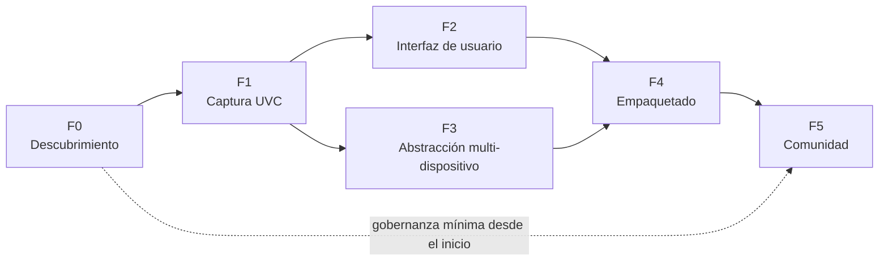

# Roadmap — Open Colposcope (nombre provisional)

> Prototipo educativo. **No es un producto médico validado.**

Las fases son **secuenciales en su puerta de salida** (no se cierra una fase sin cumplir sus
criterios de aceptación), pero el trabajo puede solaparse. No se fijan fechas: el ritmo
dependerá de la comunidad y del acceso a hardware.

## Criterios transversales (aplican a todas las fases)

- Ningún entregable contiene datos ni imágenes de pacientes reales. Las pruebas usan
  objetivos no humanos (cartas de color, maniquíes/fantomas, objetos) o material con
  licencia libre explícita.
- Ningún entregable incluye código, firmware, recursos o binarios del fabricante, ni nada
  relacionado con el dongle (ver [RISKS.md §5](RISKS.md#5-por-qué-no-se-emula-el-dongle)).
- La prueba "sin red" de CI pasa en cada cambio (a partir de F1).
- Toda decisión estructural queda en un ADR (`docs/adr/NNNN-titulo.md`).
- La documentación se escribe en español e inglés (o se marca como pendiente de traducción).

---

## F0 — Descubrimiento

**Objetivo:** confirmar con evidencia que los colposcopios objetivo pueden capturarse por
vías estándar (UVC) sin el software propietario, y cerrar las decisiones de base.

### Entregables

| # | Entregable |
|---|---|
| F0.1 | Inventario de dispositivos disponibles (marca, modelo, año, conexión) en [HARDWARE.md](HARDWARE.md). |
| F0.2 | Volcado de descriptores USB por dispositivo (`lsusb -v`, USB Device Tree Viewer, `system_profiler SPUSBDataType`), **sin números de serie**. |
| F0.3 | Prueba con aplicaciones genéricas del SO (VLC, `guvcview`/`qv4l2`, app Cámara de Windows, QuickTime/FaceTime) **sin el software del fabricante instalado y sin el dongle conectado**. |
| F0.4 | Identificación de qué dispositivo USB es la cámara y cuál es el dongle (este último sólo se registra; no se analiza). |
| F0.5 | *Spike* técnico: script desechable fuera del árbol principal que abre la cámara con OpenCV en ≥ 2 SO y lista resoluciones/FPS reales. |
| F0.6 | Revisión del EULA/condiciones del equipo y del software del fabricante; nota de riesgos legales (no es asesoría legal). |
| F0.7 | Entrevistas breves con ≥ 3 docentes/usuarios potenciales: flujos, etapas a etiquetar, uso de pedal, equipos disponibles. |
| F0.8 | Definición del equipo de referencia (hardware/SO mínimos reales en los sitios objetivo). |
| F0.9 | ADR-0001 (stack), ADR-0002 (licencia), ADR-0003 (formato de almacenamiento y esquema de metadatos). |
| F0.10 | Informe de descubrimiento con decisión **continuar / replantear**. |

### Criterios de aceptación

- [ ] ≥ 1 modelo de colposcopio confirmado como **UVC** (clase de interfaz `0x0E`) y
      visualizable con una app genérica en ≥ 2 sistemas operativos, sin software propietario.
- [ ] Para cada modelo **no UVC**, documentada una ruta alternativa legítima (capturadora UVC,
      puerto óptico + cámara UVC, SDK publicado) o marcado como "no soportado".
- [ ] Equipo de referencia y SO mínimos acordados y registrados en ARCHITECTURE.md §9.
- [ ] Licencia del proyecto elegida y `LICENSE` añadido.
- [ ] Los tres ADR iniciales aprobados por al menos un revisor además del autor.

---

## F1 — Captura UVC (núcleo sin interfaz gráfica)

**Objetivo:** biblioteca de núcleo + CLI que capturan imagen fija y video de forma fiable,
privada y verificable.

### Entregables

| # | Entregable |
|---|---|
| F1.1 | Estructura del repositorio (`src/` layout, `pyproject.toml`), linters (`ruff`), tipado (`mypy`), `pre-commit`. |
| F1.2 | Interfaces HAL (`CaptureBackend`, `CaptureSession`, `DeviceInfo`, `Frame`) según ARCHITECTURE.md §6.4. |
| F1.3 | Backend `opencv` con enumeración complementaria por SO (VID/PID, nombre). |
| F1.4 | Backend `replay` (video/carpeta de imágenes) para pruebas y demostración. |
| F1.5 | Servicios de estudio, captura, grabación segmentada, metadatos (JSON Schema v1.0) y anonimizador. |
| F1.6 | Almacenamiento con escritura atómica, SHA-256 e índice SQLite reconstruible. |
| F1.7 | CLI: `devices`, `preview` (ventana mínima de depuración), `capture`, `record`, `diagnose`, `reindex`. |
| F1.8 | CI en Linux, Windows y macOS con pruebas sobre el backend `replay`. |
| F1.9 | Prueba "sin red" en CI (ARCHITECTURE.md §8.6). |
| F1.10 | Protocolo de prueba manual con hardware real (lista de verificación reproducible). |

### Criterios de aceptación

- [ ] `capture` guarda un PNG sin pérdida cuyo contenido es idéntico al frame entregado por el
      backend (verificado con `replay`, comparación píxel a píxel).
- [ ] Grabación de 30 min a 1080p30 MJPEG en el equipo de referencia con < 1 % de frames
      perdidos, y el contador de pérdidas reportado al usuario.
- [ ] Desconectar el USB durante la grabación no corrompe segmentos cerrados; el sidecar
      registra la interrupción; el proceso no se cae.
- [ ] Cierre forzado (`kill -9`) durante una escritura no deja capturas "confirmadas" corruptas.
- [ ] Todos los sidecars validan contra el esquema; el esquema no admite campos de PII
      (prueba que intenta inyectarlos y falla).
- [ ] Ningún archivo generado contiene EXIF/XMP ni pista de audio.
- [ ] Probado con ≥ 1 colposcopio real en Linux y Windows; resultados en HARDWARE.md.
- [ ] Cobertura de pruebas ≥ 80 % en el núcleo (excluyendo adaptadores de hardware).

---

## F2 — Interfaz de usuario

**Objetivo:** aplicación de escritorio usable por docentes sin conocimientos técnicos.

### Entregables

| # | Entregable |
|---|---|
| F2.1 | GUI PySide6: selector de dispositivo, vista previa, captura, grabación, indicadores de estado (FPS, resolución, espacio libre, frames perdidos). |
| F2.2 | Flujo de estudio anónimo (abrir/cerrar), etiquetado por etapa con vocabulario controlado. |
| F2.3 | Galería del estudio con comparación lado a lado de etapas. |
| F2.4 | Exportación educativa (ZIP + manifiesto + marca de agua configurable). |
| F2.5 | Atajos de teclado y soporte de pedal HID; disparador configurable. |
| F2.6 | Avisos permanentes de uso previsto ("educativo — no diagnóstico") en arranque, "Acerca de" y exportaciones. |
| F2.7 | Internacionalización: español e inglés completos; infraestructura para más idiomas. |
| F2.8 | Modo demostración (backend `replay`) accesible desde la UI. |
| F2.9 | Pruebas de UI automatizadas (`pytest-qt`) para los flujos principales. |
| F2.10 | Guía de uso para docentes (con capturas de pantalla sin datos reales). |

### Criterios de aceptación

- [ ] Prueba de usabilidad con ≥ 3 docentes: completan "abrir estudio → capturar 3 etapas →
      exportar" sin ayuda en < 5 min.
- [ ] Latencia de vista previa < 150 ms y UI fluida en el equipo de referencia.
- [ ] Captura con pedal funciona sin que la ventana pierda la vista previa.
- [ ] Usable a 1366×768 y navegable completamente con teclado; contraste WCAG AA.
- [ ] Ningún campo de la UI solicita datos identificatorios del paciente.
- [ ] Todas las cadenas visibles están traducidas (es/en); 0 cadenas sin marcar para traducción.

---

## F3 — Abstracción multi-dispositivo

**Objetivo:** soportar varios modelos mediante perfiles y plugins, sin modificar el núcleo.

### Entregables

| # | Entregable |
|---|---|
| F3.1 | Sistema de perfiles declarativos (`profiles/<vid>_<pid>.toml`) con validación de esquema. |
| F3.2 | Mecanismo de plugins de backend vía *entry points* (`open_colposcope.backends`). |
| F3.3 | Suite de **pruebas de contrato** que cualquier backend debe pasar. |
| F3.4 | Evaluación del backend `qt` (Qt Multimedia) frente a `opencv` (ADR con resultados). |
| F3.5 | Backend `libuvc` opcional para controles UVC avanzados documentados (con advertencias de controlador). |
| F3.6 | Soporte del botón físico UVC (*still image trigger*) donde el SO lo exponga. |
| F3.7 | Herramienta `diagnose` que genera un reporte anonimizado listo para pegar en HARDWARE.md. |
| F3.8 | Soporte documentado de capturadoras UVC para colposcopios con salida analógica/HDMI. |
| F3.9 | Control de color: bloqueo de balance de blancos/exposición, registro en metadatos; guía con carta de color. |

### Criterios de aceptación

- [ ] ≥ 3 modelos distintos (incluida ≥ 1 capturadora) funcionando con perfil propio.
- [ ] Añadir un modelo nuevo requiere sólo un archivo de perfil + fila en HARDWARE.md
      (demostrado por alguien que no escribió el núcleo).
- [ ] Todos los backends incluidos pasan la suite de contrato en CI (los de hardware, con
      dispositivo simulado o marcados como prueba manual documentada).
- [ ] Un plugin externo de ejemplo (fuera del repositorio principal) se instala y se usa sin
      cambios en el núcleo.

---

## F4 — Empaquetado y distribución offline

**Objetivo:** instalación sencilla y verificable en equipos sin Internet.

### Entregables

| # | Entregable |
|---|---|
| F4.1 | Windows: instalador (PyInstaller + Inno Setup/NSIS o MSI) y **versión portable** (carpeta/ZIP). |
| F4.2 | Linux: AppImage; Flatpak como segunda opción (permiso de dispositivos de video). |
| F4.3 | macOS: `.app`/`.dmg` con `NSCameraUsageDescription`; firma/notarización si hay financiación. |
| F4.4 | Modo portable: datos y configuración junto al ejecutable (útil en memorias USB). |
| F4.5 | SBOM (CycloneDX), avisos de licencias de terceros (incluido cumplimiento LGPL de Qt), `SHA256SUMS` y firma de las versiones. |
| F4.6 | Procedimiento documentado de compilación reproducible y de publicación. |
| F4.7 | Guía de instalación para TI (permisos de cámara, cifrado de disco, antivirus, grupo `video` en Linux). |

### Criterios de aceptación

- [ ] Instalación y primera captura en una máquina limpia **sin conexión a Internet** en
      Windows 10/11 y en una distribución Linux de referencia.
- [ ] La aplicación arranca en < 5 s en el equipo de referencia.
- [ ] Tamaño del instalador documentado y justificado (objetivo orientativo < 200 MB).
- [ ] El binario no realiza conexiones de red (verificado con monitor de red durante una sesión completa).
- [ ] Los análisis de antivirus habituales no marcan el instalador (o hay procedimiento
      documentado de reporte de falso positivo).
- [ ] Todos los avisos de licencia de terceros están incluidos en el paquete.

---

## F5 — Comunidad y sostenibilidad

**Objetivo:** que otras personas e instituciones puedan contribuir, adoptar y mantener el proyecto.

### Entregables

| # | Entregable |
|---|---|
| F5.1 | `CONTRIBUTING.md`, `CODE_OF_CONDUCT.md` (Contributor Covenant), `GOVERNANCE.md`, `SECURITY.md`. |
| F5.2 | Plantillas de issues: error, mejora, **reporte de hardware** (con advertencia de no adjuntar imágenes de pacientes). |
| F5.3 | Política de contribuciones prohibidas (cracks, emuladores, firmware ajeno) y procedimiento de retirada. |
| F5.4 | Flujo de traducción comunitaria (archivos `.ts`/`.po`) con guía. |
| F5.5 | Material educativo: guía docente, plantilla de consentimiento/uso institucional, plantilla de evaluación de impacto de privacidad (DPIA). |
| F5.6 | Proceso de versiones (SemVer), changelog, calendario de soporte. |
| F5.7 | Programa de préstamo/prueba remota de hardware para contribuidores sin colposcopio. |
| F5.8 | ≥ 2 mantenedores con permisos de publicación (reduce el *bus factor*). |

### Criterios de aceptación

- [ ] Una persona externa al equipo inicial completa un PR aceptado siguiendo solo la documentación.
- [ ] ≥ 1 perfil de hardware aportado por la comunidad e integrado.
- [ ] ≥ 2 idiomas además del español mantenidos por la comunidad (p. ej., inglés y portugués).
- [ ] Proceso de reporte de vulnerabilidades probado (ejercicio simulado).
- [ ] Gobernanza con ≥ 2 mantenedores activos y regla de revisión obligatoria para `main`.
