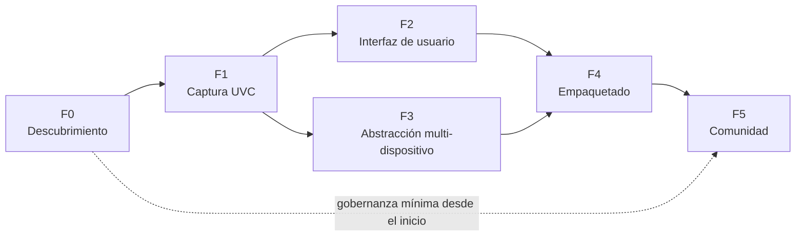

# Roadmap — Open Colposcope

> Prototipo educativo. **No es un producto médico validado.**

Las fases son **secuenciales en su puerta de salida** (no se cierra una fase sin cumplir sus
criterios de aceptación), pero el trabajo puede solaparse. No se fijan fechas: el ritmo
dependerá de la comunidad y del acceso a hardware.

## Criterios transversales (aplican a todas las fases)

- Ningún entregable contiene datos ni imágenes de pacientes reales. Las pruebas usan
  objetivos no humanos (cartas de color, maniquíes/fantomas, objetos) o material con
  licencia libre explícita.
- Ningún entregable incluye código, firmware, recursos o binarios del fabricante, ni nada
  relacionado con el dongle (ver [RISKS.md §5](RISKS.md#5-por-qué-no-se-emula-el-dongle)).
- La prueba "sin red" de CI pasa en cada cambio (a partir de F1).
- Toda decisión estructural queda en un ADR (`docs/adr/NNNN-titulo.md`).
- La documentación se escribe en español e inglés (o se marca como pendiente de traducción).

---

## F0 — Descubrimiento ✅ (cerrada)

**Resultado:** Goldcare GC 3000E confirmado como UVC en Windows 10 sin software del fabricante
ni dongle; equipos de destino Windows 10/11 x64; licencias Apache-2.0 (código) y CC-BY-4.0
(documentación); stack confirmado (STACK.md); sin pacientes en F1–F3. Pendiente menor: VID:PID
del GC 3000E (se obtiene con `colpo list` en el equipo del sitio; ver HARDWARE.md).

**Objetivo:** confirmar con evidencia que los colposcopios objetivo pueden capturarse por
vías estándar (UVC) sin el software propietario, y cerrar las decisiones de base.

### Entregables

| # | Entregable |
|---|---|
| F0.1 | Inventario de dispositivos disponibles (marca, modelo, año, conexión) en [HARDWARE.md](HARDWARE.md). |
| F0.2 | Volcado de descriptores USB por dispositivo (`lsusb -v`, USB Device Tree Viewer, `system_profiler SPUSBDataType`), **sin números de serie**. |
| F0.3 | Prueba con aplicaciones genéricas del SO (VLC, `guvcview`/`qv4l2`, app Cámara de Windows, QuickTime/FaceTime) **sin el software del fabricante instalado y sin el dongle conectado**. |
| F0.4 | Identificación de qué dispositivo USB es la cámara y cuál es el dongle (este último sólo se registra; no se analiza). |
| F0.5 | *Spike* técnico: script desechable fuera del árbol principal que abre la cámara con OpenCV en ≥ 2 SO y lista resoluciones/FPS reales. |
| F0.6 | Revisión del EULA/condiciones del equipo y del software del fabricante; nota de riesgos legales (no es asesoría legal). |
| F0.7 | Entrevistas breves con ≥ 3 docentes/usuarios potenciales: flujos, etapas a etiquetar, uso de pedal, equipos disponibles. |
| F0.8 | Definición del equipo de referencia (hardware/SO mínimos reales en los sitios objetivo). |
| F0.9 | ADR-0001 (stack), ADR-0002 (licencia), ADR-0003 (formato de almacenamiento y esquema de metadatos). |
| F0.10 | Informe de descubrimiento con decisión **continuar / replantear**. |

### Criterios de aceptación

- [ ] ≥ 1 modelo de colposcopio confirmado como **UVC** (clase de interfaz `0x0E`) y
      visualizable con una app genérica en ≥ 2 sistemas operativos, sin software propietario.
- [ ] Para cada modelo **no UVC**, documentada una ruta alternativa legítima (capturadora UVC,
      puerto óptico + cámara UVC, SDK publicado) o marcado como "no soportado".
- [ ] Equipo de referencia y SO mínimos acordados y registrados en ARCHITECTURE.md §9.
- [ ] Licencia del proyecto elegida y `LICENSE` añadido.
- [ ] Los tres ADR iniciales aprobados por al menos un revisor además del autor.

---

## F1 — Captura UVC (núcleo sin interfaz gráfica)

**Objetivo:** biblioteca de núcleo + CLI que capturan imagen fija y video de forma fiable,
privada y verificable.

**Alcance acordado al cerrar F0 (F1.a, entregado):** clase `UVCCamera` en
`src/colpo/capture.py` (enumeración, apertura por índice, resolución/FPS reales, `read_frame`,
`snapshot`, `start_recording`/`stop_recording`, errores explícitos), CLI `colpo`
(`list`, `preview`, `record`, `snapshot`), video sintético en `examples/synthetic_video.py`,
pruebas sin hardware, `docs/CAPTURE.md`. Puerta de salida hacia F2: `ruff` y `pytest` en verde.

**F1.b (pendiente, antes de exponer la GUI a usuarios):** estudios con `study_id`, sidecar
JSON con hora exacta y esquema validado, índice SQLite, video segmentado. Estado por
entregable en la tabla siguiente.

### Entregables

| # | Entregable | Estado |
|---|---|---|
| F1.1 | Estructura del repositorio (`src/` layout, `pyproject.toml`), `ruff` (lint + formato). `mypy` y `pre-commit`. | ✅ ruff · ⏳ mypy/pre-commit |
| F1.2 | `UVCCamera`, `DeviceInfo`, `Frame`, `StreamInfo`; jerarquía de errores. Las interfaces HAL formales (ARCHITECTURE.md §6.4) se extraen en F3. | ✅ |
| F1.3 | Backend OpenCV con enumeración por SO (nombre, VID:PID) vía `cv2-enumerate-cameras` y sondeo de índices como respaldo. | ✅ |
| F1.4 | Fuente de archivo (`UVCCamera(source=...)`) para pruebas y demostración. | ✅ |
| F1.5 | Estudios, sidecar JSON con hora exacta (JSON Schema v1.0) y anonimizador. | ⏳ F1.b |
| F1.6 | Escritura atómica de fotos y videos ✅; SHA-256, índice SQLite y video segmentado. | ✅ parcial · ⏳ F1.b |
| F1.7 | CLI: `list`, `preview`, `record`, `snapshot` ✅; `diagnose`, `reindex`. | ✅ · ⏳ F1.b/F3 |
| F1.8 | CI en Windows y Linux con video sintético (`.github/workflows/ci.yml`). | ✅ (macOS: best effort) |
| F1.9 | Prueba "sin red" (estática y dinámica). | ✅ |
| F1.10 | Protocolo de prueba manual con hardware real (CAPTURE.md §6). | ✅ redactado · ⏳ ejecutar con el GC 3000E |

### Criterios de aceptación

- [ ] `capture` guarda un PNG sin pérdida cuyo contenido es idéntico al frame entregado por el
      backend (verificado con `replay`, comparación píxel a píxel).
- [ ] Grabación de 30 min a 1080p30 MJPEG en el equipo de referencia con < 1 % de frames
      perdidos, y el contador de pérdidas reportado al usuario.
- [ ] Desconectar el USB durante la grabación no corrompe segmentos cerrados; el sidecar
      registra la interrupción; el proceso no se cae.
- [ ] Cierre forzado (`kill -9`) durante una escritura no deja capturas "confirmadas" corruptas.
- [ ] Todos los sidecars validan contra el esquema; el esquema no admite campos de PII
      (prueba que intenta inyectarlos y falla).
- [ ] Ningún archivo generado contiene EXIF/XMP ni pista de audio.
- [ ] Probado con ≥ 1 colposcopio real en Windows 10/11 (GC 3000E); resultados en HARDWARE.md.
- [ ] Cobertura de pruebas ≥ 80 % en el núcleo (excluyendo adaptadores de hardware).

---

## F2 — Interfaz de usuario (v0.2.0-ui: implementada; pendiente prueba con el GC 3000E)

**Objetivo:** aplicación de escritorio usable por docentes sin conocimientos técnicos.

**Alcance acordado para v0.2.0-ui:** ventana PySide6 (`colpo-ui`) con selector de cámara,
vista previa, resolución/FPS, foto, grabación MP4 (H.264 con `mp4v` de respaldo), etapa
IFCPC, notas sin identificadores, banner permanente, errores visibles, i18n ES/EN en caliente,
metadatos JSON con lista cerrada y `docs/USER_GUIDE.md`. Fuera de F2 (pasa a F3): comparación
lado a lado, anotaciones sobre la imagen, exportación (ZIP/PDF), marca de agua visible en la
UI, integración con historias clínicas.

### Entregables

| # | Entregable |
|---|---|
| F2.1 | GUI PySide6: selector de dispositivo, vista previa, captura, grabación, indicadores de estado (FPS, resolución, espacio libre, frames perdidos). |
| F2.2 | Flujo de estudio anónimo (abrir/cerrar), etiquetado por etapa con vocabulario IFCPC configurable. |
| F2.3 | ~~Galería del estudio con comparación lado a lado de etapas.~~ **Movido a F3.** |
| F2.4 | ~~Exportación educativa.~~ **Movido a F3.** En F2 solo existe el gancho de marca de agua, desactivado. |
| F2.5 | Disparo por teclado y ratón (no hay pedal conocido); un pedal HID que emule teclado funcionará sin cambios. |
| F2.6 | Avisos permanentes de uso previsto ("educativo — no diagnóstico") en arranque, "Acerca de" y exportaciones. |
| F2.7 | Internacionalización: español e inglés completos desde F2; infraestructura para más idiomas. |
| F2.8 | Modo demostración (backend `replay`) accesible desde la UI. |
| F2.9 | Pruebas de UI automatizadas (`pytest-qt`) para los flujos principales. |
| F2.10 | Guía de uso para docentes (con capturas de pantalla sin datos reales). |

### Criterios de aceptación

- [ ] Prueba de usabilidad con ≥ 3 docentes: completan "abrir estudio → capturar 3 etapas →
      exportar" sin ayuda en < 5 min.
- [ ] Latencia de vista previa < 150 ms y UI fluida en el equipo de referencia.
- [ ] Captura con pedal funciona sin que la ventana pierda la vista previa.
- [ ] Usable a 1366×768 y navegable completamente con teclado; contraste WCAG AA.
- [ ] Ningún campo de la UI solicita datos identificatorios del paciente.
- [ ] Todas las cadenas visibles están traducidas (es/en); 0 cadenas sin marcar para traducción.

---

## F3 — Abstracción multi-dispositivo (v0.3.0: implementada; pendiente prueba con el GC 3000E)

**Objetivo:** que cualquier colaborador añada un dispositivo sin tocar el núcleo, y que la app
maneje varios dispositivos a la vez (colposcopio + webcam o capturadora).

### Entregables

| # | Entregable | Estado |
|---|---|---|
| F3.1 | Contrato `CameraDriver` + `Capabilities` + errores de dominio (`src/colpo/drivers/`). | ✅ |
| F3.2 | `UVCCamera` como driver puro; foto/video/metadatos en `CaptureCamera` para cualquier driver. | ✅ |
| F3.3 | Registro por *entry points* `colpo.drivers` + registro manual; `probe_all`. | ✅ |
| F3.4 | Perfiles JSON por VID:PID con validación; perfil del Goldcare GC 3000E. | ✅ (VID:PID pendiente) |
| F3.5 | `MockDriver` didáctico (video sintético, ocupado, inexistente, desconexión, formato). | ✅ |
| F3.6 | Suite de contrato parametrizable (`tests/test_driver_contract.py`), con modo hardware. | ✅ |
| F3.7 | UI multi-dispositivo: selector agrupado por driver con VID:PID y capacidades, pestañas, cambio en caliente. | ✅ |
| F3.8 | Marca de agua opcional en preferencias (foto y video), desactivada por defecto. | ✅ |
| F3.9 | `docs/NON_UVC.md` (capturadora, puerto óptico, SDK publicado) y `docs/DRIVER_GUIDE.md`. | ✅ |
| F3.10 | Backends `qt`/`libuvc`, botón físico UVC, `diagnose`, control de color. | ⏳ Pasan a F4/F5 según demanda |

### Criterios de aceptación

- [x] `UVCCamera` y `MockDriver` implementan `CameraDriver` y pasan la suite de contrato.
- [x] Añadir un driver requiere solo archivo + *entry point* + suite (verificado con un paquete
      externo de ejemplo instalado con `pip`, sin cambios en núcleo ni UI).
- [x] Marca de agua solo si el usuario la activa (pruebas de foto y video).
- [x] `ruff` y `pytest` en verde.
- [ ] La app detecta y usa a la vez el Goldcare GC 3000E y un segundo dispositivo UVC
      (webcam del portátil). **Prueba manual pendiente.**
- [ ] Prueba manual con el Goldcare: cambiar de dispositivo, activar marca de agua, foto y
      video con y sin marca de agua.

## F4 — Empaquetado y distribución offline

**Objetivo:** instalación sencilla y verificable en equipos sin Internet.

### Entregables

| # | Entregable |
|---|---|
| F4.1 | **Prioritario.** Windows 10/11 x64: PyInstaller + instalador (Inno Setup/NSIS o MSI) y **versión portable** (carpeta/ZIP). |
| F4.2 | Secundario (si hay demanda): Linux AppImage; Flatpak como segunda opción. |
| F4.3 | Secundario (si hay demanda y fondos): macOS `.app`/`.dmg` con `NSCameraUsageDescription`, firma/notarización. |
| F4.4 | Modo portable: datos y configuración junto al ejecutable (útil en memorias USB). |
| F4.5 | SBOM (CycloneDX), avisos de licencias de terceros (incluido cumplimiento LGPL de Qt), `SHA256SUMS` y firma de las versiones. |
| F4.6 | Procedimiento documentado de compilación reproducible y de publicación. |
| F4.7 | Guía de instalación para TI (permisos de cámara, cifrado de disco, antivirus, grupo `video` en Linux). |
| F4.8 | Habilitación de captura clínica educativa en entorno controlado: lista de verificación de PRIVACY.md (comité de ética, consentimiento informado, Ley 29733, anonimización obligatoria). |
| F4.9 | Verificación previa por sitio (RISKS.md T16) documentada y ejecutada en cada sitio nuevo. |

### Criterios de aceptación

- [ ] Instalación y primera captura en una máquina limpia **sin conexión a Internet** en
      Windows 10/11 x64 (instalador PyInstaller).
- [ ] Ninguna captura de pacientes antes de completar la lista de verificación de PRIVACY.md.
- [ ] La aplicación arranca en < 5 s en el equipo de referencia.
- [ ] Tamaño del instalador documentado y justificado (objetivo orientativo < 200 MB).
- [ ] El binario no realiza conexiones de red (verificado con monitor de red durante una sesión completa).
- [ ] Los análisis de antivirus habituales no marcan el instalador (o hay procedimiento
      documentado de reporte de falso positivo).
- [ ] Todos los avisos de licencia de terceros están incluidos en el paquete.

---

## F5 — Comunidad y sostenibilidad

**Objetivo:** que otras personas e instituciones puedan contribuir, adoptar y mantener el proyecto.

### Entregables

| # | Entregable |
|---|---|
| F5.1 | `CONTRIBUTING.md`, `CODE_OF_CONDUCT.md` (Contributor Covenant), `GOVERNANCE.md`, `SECURITY.md`. |
| F5.2 | Plantillas de issues: error, mejora, **reporte de hardware** (con advertencia de no adjuntar imágenes de pacientes). |
| F5.3 | Política de contribuciones prohibidas (cracks, emuladores, firmware ajeno) y procedimiento de retirada. |
| F5.4 | Flujo de traducción comunitaria (archivos `.ts`/`.po`) con guía. |
| F5.5 | Material educativo: guía docente, plantilla de consentimiento/uso institucional, plantilla de evaluación de impacto de privacidad (DPIA). |
| F5.6 | Proceso de versiones (SemVer), changelog, calendario de soporte. |
| F5.7 | Programa de préstamo/prueba remota de hardware para contribuidores sin colposcopio. |
| F5.8 | ≥ 2 mantenedores con permisos de publicación (reduce el *bus factor*). |

### Criterios de aceptación

- [ ] Una persona externa al equipo inicial completa un PR aceptado siguiendo solo la documentación.
- [ ] ≥ 1 sitio o institución adicional verificado según RISKS.md T16.
- [ ] ≥ 1 perfil de hardware aportado por la comunidad e integrado.
- [ ] ≥ 2 idiomas además del español mantenidos por la comunidad (p. ej., inglés y portugués).
- [ ] Proceso de reporte de vulnerabilidades probado (ejercicio simulado).
- [ ] Gobernanza con ≥ 2 mantenedores activos y regla de revisión obligatoria para `main`.
